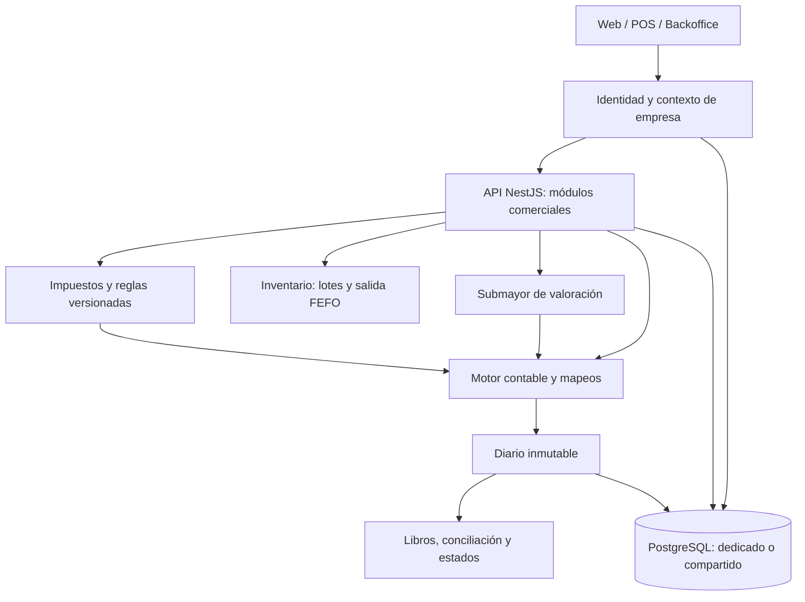

# FarmaControl — Arquitectura híbrida y plan de implementación contable

**Versión:** 1.0  
**Fecha:** 24 de octubre de 2026  
**Estado:** aprobado como documento rector y en ejecución por fases. F0 y F1 están cerradas; las decisiones aprobadas están en ADR-003, ADR-004 y ADR-005 (actualizado el 25 de octubre de 2026)  
**Base documental:** auditoría contable recibida de Codex (AUD-CT-001 a AUD-CT-008). La auditoría fue estática y no ejecutó pruebas.

## 1. Decisión de producto

FarmaControl tendrá **un único código base y una única evolución del esquema**, con dos modalidades de despliegue:

| Modalidad      | Destino                                    | Aislamiento                                                                                                                                                                 |
| -------------- | ------------------------------------------ | --------------------------------------------------------------------------------------------------------------------------------------------------------------------------- |
| **Dedicada**   | Una farmacia, droguería o empresa cliente  | Una instancia de aplicación y una base PostgreSQL por empresa; el esquema conserva `companyId` y solo existe una empresa activa.                                            |
| **Compartida** | Varias empresas clientes en una plataforma | Una aplicación y una base PostgreSQL con varias empresas; aislamiento obligatorio por `companyId`, restricciones de base de datos, autorización y pruebas de fuga de datos. |

**No se desarrollarán dos variantes funcionales de FarmaControl.** Los despliegues usarán el mismo motor contable, reglas, migraciones y pruebas. `DEPLOYMENT_MODE` solo gobernará cómo se aprovisionan empresas y la posibilidad de tener más de una empresa, no cambiará la lógica contable.

La **empresa** es la entidad jurídica y frontera de datos. La **sucursal** pertenece a una empresa y puede tener caja, ubicación de inventario y numeraciones propias. Una sucursal nunca equivale a otro `companyId`.

**Actualización 2026-10-25 ([ADR-006](adr/ADR-006-producto-multisector-y-contabilidad-configurable.md)):** el producto pasa a ser **multisector** para Colombia. POS, inventario y catálogo dejan de suponer farmacia, la farmacia queda como un perfil sectorial y la contabilidad se configura por empresa. Las fases F3–F8 de la sección 5 se reorganizan según ADR-006.

## 2. Principios que no se negocian

1. **Una empresa no puede leer, modificar ni inferir datos de otra**, aunque se conozca un ID, una URL o un código de documento.
2. **Partida doble obligatoria**: todo asiento publicado queda cuadrado, con documento de origen, usuario, fecha, empresa y reglas aplicadas.
3. **Operación comercial y asiento obligatorio son atómicos** mientras compartan PostgreSQL: si no se puede contabilizar, no se confirma la operación. La respuesta explica qué configuración falta. Reintentos idempotentes.
4. **FEFO físico y valoración contable son conceptos separados**. El catálogo no es la fuente del costo histórico de una venta.
5. **No hay defaults fiscales silenciosos**: 0 % de IVA solo es válido cuando existe una clasificación y una regla explícitas; `sin configurar` no significa `excluido`.
6. **Historial reproducible**: la operación conserva una instantánea de importes, impuestos, costo aplicado y versión de reglas. Modificar la configuración no altera asientos publicados.
7. **Configuración por empresa**, con aprobación, vigencia y trazabilidad para los cambios que afecten cifras.
8. **Los asientos publicados no se editan ni eliminan**: se corrigen por reversos o ajustes aprobados; los cierres bloquean períodos.
9. **No se supone cumplimiento DIAN** por imprimir un comprobante: el documento fiscal electrónico se integra y valida mediante un componente separado.
10. **Migraciones seguras**, aditivas y verificadas sobre una copia representativa antes de tocar datos operativos.

## 3. Arquitectura objetivo

### 3.1. Modelo y límites

- **Identidad/tenencia:** `Company`, `Branch`, `User`, `CompanyMembership` y roles/permisos acotados por empresa. El servidor determina la empresa autorizada desde la sesión o token validado; no confía en un `companyId` suministrado por el navegador sin verificar pertenencia.
- **Configuración:** `CompanyAccountingSettings`, plan de cuentas, mapeos por propósito, políticas con fecha de vigencia, perfil fiscal y documento de aprobación.
- **Operación:** ventas, compras, cartera, gastos, caja, bancos, inventario, notas y sus terceros. Cada entidad propiedad de una empresa tiene ámbito explícito; las referencias entre entidades de empresa deben quedar protegidas con restricciones que impidan cruzar empresas.
- **Inventario y costo:** movimientos físicos por producto, lote y ubicación; movimientos de valoración con costo histórico, origen, cantidades y contrapartida contable. El método contable configurado se aplica independientemente del orden FEFO.
- **Contabilidad:** `JournalEntry`, `JournalEntryLine`, cuentas, propósitos, períodos y saldos de apertura por empresa. Líneas con tercero o referencias auxiliares cuando la operación lo exija.
- **Documentos fiscales:** adaptador para proveedor/facturador, secuencias por empresa y sede cuando aplique, estados de envío/validación separados del asiento interno, reintentos idempotentes.
- **Procesos diferidos:** jobs, alertas, respaldos, exportaciones, caché y reportes contienen el ámbito de empresa y aplican la misma autorización. No basta aislar las consultas HTTP.

### 3.2. Separación de datos

**Dedicado:** cada empresa tiene su propia base y sus respaldos. También usa `companyId` dentro del esquema para mantener compatible el código con el modo compartido.

**Compartido:** en PostgreSQL, toda clave única de negocio que deba repetirse entre empresas es compuesta (por ejemplo, `companyId + accountCode`, `companyId + year + month`, `companyId + documentNumber` cuando corresponda). Las relaciones entre entidades deben impedir referencias cruzadas, por ejemplo mediante FKs compuestas cuando resulte viable.

Las consultas se acotan por empresa desde el servidor y se prueban en módulos operativos, contables, worker y reportes. Evaluar Row Level Security (RLS) como defensa adicional; si se adopta, probar expresamente su uso con Prisma, pool de conexiones y contexto transaccional. RLS no sustituye autorización ni pruebas.

No se habilitará el modo compartido hasta superar una batería de pruebas de aislamiento con al menos dos empresas, sucursales y usuarios diferentes.

### 3.3. Configuración inicial

El asistente debe poder: identificar empresa y sedes, elegir plantilla contable, validar cuentas y mapeos, registrar obligaciones y clasificación tributaria, seleccionar política de costeo, definir caja/bancos, importar inventario y saldos iniciales, autorizar usuarios y marcar una **fecha de corte contable**.

Un estado `DRAFT / REVIEW_REQUIRED / READY` evita emitir operaciones con configuración contable obligatoria incompleta. Una plantilla PUC es una ayuda importable; no es un conjunto de reglas universales. Se conservan versiones de los mapeos y de la clasificación tributaria aplicada a cada operación.

## 4. Decisiones tomadas y pendientes

| Asunto                  | Definición para avanzar                                                                                                                                                                                                                                                                                                |
| ----------------------- | ---------------------------------------------------------------------------------------------------------------------------------------------------------------------------------------------------------------------------------------------------------------------------------------------------------------------- |
| Modelo comercial        | **Aprobado: híbrido**, con un solo repositorio y dos formas de despliegue.                                                                                                                                                                                                                                             |
| Modelo de datos         | **Propuesto:** esquema preparado para `companyId` en ambos modos, incorporación gradual mediante migraciones aditivas.                                                                                                                                                                                                 |
| Fallo de asiento        | **Aprobado** ([ADR-004](adr/ADR-004-atomicidad-operativa-contable.md)) e implementado en F1: se bloquea y se revierte la operación completa; no se permiten asientos faltantes en silencio.                                                                                                                            |
| Costeo                  | **Aprobado el 2026-10-25** ([ADR-005](adr/ADR-005-politica-de-costeo-del-inventario.md)): promedio ponderado móvil, separado de FEFO; apertura al último costo de compra; devoluciones al costo de salida. Falta la fecha de corte. Otros métodos se incorporarían en versiones posteriores, con migración controlada. |
| Datos históricos        | Preservar asientos y costos existentes; documentar diferencias no reconstruibles. Adoptar apertura/ajuste aprobado desde fecha de corte si no hay evidencia suficiente para recalcular.                                                                                                                                |
| Impuestos               | Clasificación explícita por establecimiento, producto y operación, con vigencia. Validación profesional antes de activar la operación real.                                                                                                                                                                            |
| Facturación electrónica | Adaptador independiente; proveedor y responsabilidades fiscales se decidirán por cliente.                                                                                                                                                                                                                              |
| Sucursales              | Dimensionar caja, stock y reportes por sede cuando el modelo actual lo permita; separar de empresa.                                                                                                                                                                                                                    |
| Seguridad compartida    | Autorización, FKs/índices compuestos y pruebas de aislamiento son obligatorios; RLS se evalúa antes de lanzar modo compartido.                                                                                                                                                                                         |

## 5. Fases de trabajo para Codex

Cada fase termina con evidencia de pruebas, riesgos, migraciones y criterios de aceptación. **Una fase no se mezcla con la siguiente sin revisión.**

### F0 — Línea base y decisiones de arquitectura (sin cambios funcionales)

**Trabajo:** revisar la rama actual y el estado de `main`; reproducir hallazgos AUD-CT-001…008 en código y pruebas; comparar tests vigentes; mapear entidades a `companyId`, referencias, endpoints, workers y reportes; preparar ADR del modelo híbrido y plan de migración. Separar hechos confirmados de hipótesis de la auditoría estática.

**Entregables:** mapa de datos por empresa; matriz de riesgos; ADR de modo dedicado/compartido; plan de transición; lista de decisiones contables todavía pendientes; orden de PR pequeños.

**Salida:** no se aprueba implementación masiva sin haber delimitado el estado actual y el camino de migración.

### F1 — Integridad del asiento y eliminación de fallbacks peligrosos

**Trabajo:** impedir que venta, compra, pago o gasto que requiera asiento se confirme sin asiento; eliminar retorno silencioso `null`; sustituir selección arbitraria de cuentas, especialmente el fallback de `3605` y de patrimonio. Comprobar idempotencia y bloqueo de período.

**Criterios:** rollback completo ante mapeo ausente; mensaje accionable; cero asientos descuadrados o repetidos; pruebas PostgreSQL de concurrencia, fallos y reintentos. Sustituir la prueba T-31 si valida el comportamiento incorrecto.

### F2 — Submayor de costos y valorización del inventario

**Trabajo:** registrar costos históricos de adquisición; definir método autorizado; enlazar la cantidad consumida por FEFO con el cálculo de costo contable; calcular costo de ventas desde el submayor, no desde `Product.baseCost`; soportar bonificaciones, devoluciones, ajustes y apertura. No recalcular silenciosamente ejercicios anteriores.

**Criterios:** compras con costos diferentes y ventas FEFO; costo histórico inmutable; conciliación `existencias iniciales + entradas - salidas ± ajustes = existencias finales` para unidades y valor, considerando las reglas del método; asientos de costo y reportes consistentes.

### F3 — Reglas tributarias reales

**Trabajo:** conectar perfiles ya existentes con ventas y compras, guardar impuesto/tratamiento/versión en cada línea y su asiento, eliminar tarifa cero implícita, validar descuentos/devoluciones y preparar interfaz con documentos electrónicos.

**Criterios:** perfiles por fecha y producto; operaciones sin configuración requerida bloqueadas; compras con impuestos clasificados correctamente; modificar una tarifa futura no cambia documentos antiguos; tests con productos gravados, excluidos y exentos configurados, sin presuponer tratamientos.

### F4 — Modelo `Company`, `Branch` y migración a esquema híbrido

**Trabajo:** incorporar ámbito de empresa a módulos operativos y contables, autenticación y permisos, documentos, índices, FKs y workers. Hacer backfill de datos heredados a una `Company` única conocida y de sus sedes. Preservar IDs y asientos; simular la migración antes de producción.

**Criterios:** sin pérdida de datos; restauración probada; cuentas y períodos repetibles entre empresas; cero accesos cruzados en API, exportaciones, jobs, websockets si existen y consultas por ID; E2E con dos empresas y usuarios distintos. No habilitar despliegue compartido todavía.

### F5 — Plantillas y asistente de configuración contable

**Trabajo:** plantilla PUC opcional, mapeos semánticos por empresa, validaciones, versiones y aprobaciones; saldos de apertura por tercero, fecha de corte y cuentas de control; separación entre dueño, administrador y contador. Modo dedicado crea la única empresa en el aprovisionamiento; compartido permite varias empresas por un proceso administrativo seguro.

**Criterios:** configurar dos droguerías con diferentes planes y tratamiento tributario sin cambiar código; impedir contabilizar con mapeo incompleto; apertura balanceada; permisos comprobados.

### F6 — Cobertura contable completa y reportes

**Trabajo:** asientos de ajustes de inventario, bajas por vencimiento, movimientos manuales de caja/bancos, devoluciones a proveedor, transferencias y otras operaciones observadas sin cobertura. Sustituir clasificación por naturaleza débito/crédito cuando el reporte exige naturaleza semántica. Consolidar libro diario, mayor, balance de prueba, situación financiera, resultados y conciliaciones de auxiliares.

**Criterios:** todos los movimientos definidos tienen asiento o una exclusión documentada; ninguna cuenta se infiere solo por código; período cerrado bloqueado; estados conciliados con mayor y submayores.

### F7 — Hardening multiempresa y despliegues

**Trabajo:** empaquetar la misma versión para dedicado y compartido; verificar backups/restauración (por empresa en dedicado y estrategia segura de recuperación en compartido), observabilidad con ámbito de empresa sin exponer datos, límites y colas, procedimientos de alta/baja de empresas; evaluar e implementar RLS si supera pruebas de integración.

**Criterios:** pruebas de aislamiento ofensivas, migración compatible con ambos despliegues, restauración y UAT por modalidad. Solo entonces se habilita modo compartido.

### F8 — UAT y salida controlada

**Trabajo:** probar con una droguería sencilla, una farmacia con cartera y una empresa con más de una sede; validar compra, venta, devolución, gasto, arqueo, costo, impuestos, cierre y reportes con contador. Probar recuperación de respaldos y procesos de rollback de despliegue.

**Criterios:** firmas de responsables, diferencias conciliadas o registradas, cero hallazgos críticos de integridad o aislamiento, manual de configuración y soporte actualizado. Producción solo con aprobación expresa.

## 6. Reglas de ejecución y entrega

- Usar el monolito modular actual NestJS/React/Prisma/PostgreSQL. No introducir microservicios ni cambiar el stack sin evidencia de necesidad.
- Mantener un PR acotado por fase o subfase; no mezclar refactor amplio con migraciones riesgosas.
- Antes de cada PR: `git status`, `git diff`, inventario de archivos afectados y dependencias. No sobrescribir cambios ajenos.
- Cada migración incluye verificación previa, estrategia de corte, comprobación de conteos y saldos, y ensayo de restauración. No editar migraciones ya aplicadas.
- Ejecutar pruebas unitarias, de integración con PostgreSQL, concurrencia, E2E y seguridad específicas de lo cambiado; guardar comandos y resultados reales, sin afirmar pruebas no ejecutadas.
- Reportar archivo, función y línea exacta cuando se confirmen hallazgos en el estado actual del repositorio. No dar por cierta una referencia antigua sin volver a comprobarla.
- Si el método de valoración, el perfil tributario o la fecha de corte requieren decisión del cliente/contador, parar ese tramo y documentar la elección. No inventar una política universal.
- La auditoría independiente y el estado de CI son puertas obligatorias antes de fusionar a `main`. No hacer merge o desplegar sin autorización.

## 7. Prompt inmediato para Codex — ejecutar solo F0

> Eres Codex trabajando dentro del repositorio FarmaControl. Toma como documento rector `FarmaControl_Arquitectura_Hibrida_Plan_Implementacion.md` y revisa la auditoría AUD-CT-001 a AUD-CT-008. El propietario aprobó un modelo **híbrido**: el mismo producto debe funcionar en despliegues dedicados (una empresa/base de datos) y compartidos (varias empresas aisladas en una base). No habrá dos versiones de código.
>
> **Ejecuta únicamente F0 — Línea base y decisiones de arquitectura.** Inspecciona el repositorio y confirma o refuta cada hallazgo con referencias actuales. Identifica la rama, commit base, estado de cambios y cobertura existente. Traza todas las entidades operativas/contables, claves, permisos, workers, exportaciones y reportes que necesitarán aislamiento; separa empresa de sucursal. Evalúa el impacto de migraciones aditivas, datos previos y modo dedicado. Propón el ADR, las decisiones pendientes, el orden de PR pequeños y las pruebas de aceptación de F1 a F8.
>
> No modifiques lógica comercial, contable, esquema de base de datos ni migraciones en esta fase. Si generas documentación, hazlo en una rama de trabajo sin fusionar. No realices operaciones destructivas ni `git push` o merge sin mi aprobación. No inventes resultados de CI ni ejecuciones de pruebas. Entrégame un informe con hallazgos verificados, archivos afectados, alternativas, riesgos y una recomendación clara para iniciar F1. Detente para revisión.

---

**Nota de alcance:** este documento decide la arquitectura y organiza el trabajo. No aprueba una política fiscal/contable para un contribuyente particular, no certifica los hallazgos estáticos ni autoriza migraciones en producción.
